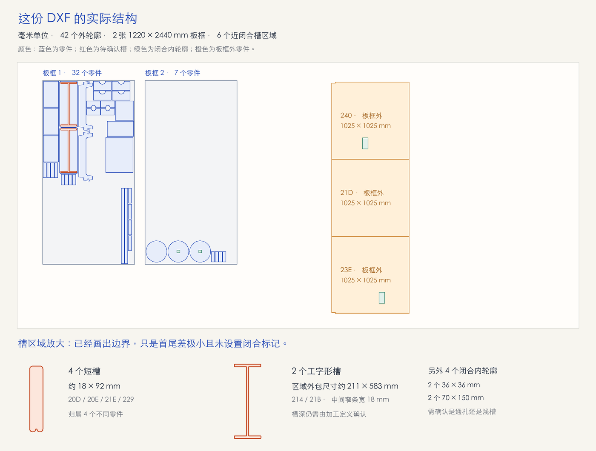

# 实际 DXF 检查 · 2026-10-13

源文件：`/Users/mr9esx/Downloads/NFB_JHB_STD_245x1282x454_SA_AP_1_0_0_cad-1_18.000-0(1).0_Copy(1).dxf`。只读检查，未修改源文件、导入器或用户工作区。

## 读取结果

文件 263,213 字节，声明毫米单位。模型空间包含 54 个加工/板框图形：51 个 LWPOLYLINE、3 个 CIRCLE；另有布局空间 VIEWPORT，当前读取器正确将其当作辅助显示对象，不阻断模型导入。没有 TEXT/MTEXT 零件编号。未出现未知实体、非平面或曲线解析失败。

| 图层 | 几何数量 | 检查结果 |
| --- | ---: | --- |
| `0` | 2 | 两个有效的 1220 × 2440 mm 矩形板框 |
| `TOP-CUT-OUTSIDE_18.000MM` | 42 | 39 个多段线和 3 个圆，均为有效闭合外轮廓 |
| `TOP-CUT-INSIDE_18.000MM` | 8 | 4 个近闭合槽边界 + 4 个有效闭合内轮廓，用途需要分别确认 |
| `TOP-POCKET-INSIDE_12.000MM` | 2 | 2 个近闭合工字形槽区域 |

第一板框含 32 个外轮廓，第二板框含 7 个。另有 3 个 1025 × 1025 mm 外轮廓位于板框之外（实体 `21D`、`23E`、`240`）。

## 6 项“未闭合”的根因

这六个实体的闭合标记为 0，但已经沿区域边界返回起点附近；并非一根槽中心线：

| 实体 | 原始首尾距离 / mm | 几何与唯一所属外轮廓 |
| --- | ---: | --- |
| `20D` | 0.0000019045 | 约 18 × 92 mm 短槽，所属 `211` |
| `20E` | 0.0000019044 | 约 18 × 92 mm 短槽，所属 `210` |
| `21E` | 0.0000019044 | 约 92 × 18 mm 短槽，所属 `21F` |
| `229` | 0.0000019045 | 约 18 × 92 mm 短槽，所属 `22A` |
| `214` | 0.0000034461 | 工字形区域外包约 211 × 583 mm，所属 `213` |
| `21B` | 0.0000034461 | 工字形区域外包约 211 × 583 mm，所属 `21A` |

工字形区域中间窄条宽 18 mm，外包宽度不是槽宽。

当前 `drawingDocument.ts` 对多段线重复末点采用原坐标 `< 1e-7` 判定，比这些误差还小，因此六个实体均被列为开放路径。这与 LINE/ARC 链的毫米容差处理不一致。上次增加的“用户定义开放槽”未解决这种近重复端点归一化；四个短槽即使明确选择“连接两端成区域”，仍会因微小回折/退化末边被轮廓校验拒绝。

更合适的通用处理是在毫米坐标中归一近重复首尾点，保留弧段，去除退化末边，再独立校验完整区域、归属和加工用途。不能把已画出的区域边界再按中心线加宽，也不能为了通过导入而忽略这六个槽。

## 独立验证与导入限制

仅在内存副本删除这六个近重复末点、标记闭合后，六个轮廓均通过有效性和唯一零件归属检查。在诊断试算中忽略板框、指定 42 个外轮廓，并暂将另外 4 个闭合内轮廓视作孔，成功生成 **42 个零件、4 个孔、6 个槽**。试算所用 1 mm 槽深只是为了验证几何管线，不是该文件的实际加工参数，也未提交到网站。

另外 4 个内轮廓分别为两个 36 × 36 mm 和两个 70 × 150 mm 的矩形；通孔或浅槽需要工艺确认。图层名称中的 18/12 数字没有在本次检查中自动转为实际板厚、槽宽或槽深。

同样的归一化副本按整板导入仍被当前模型拒绝，具体错误为“存在未被板框完整包含的零件”，对应上述 3 个板框外零件。更完整的导入应保留两板上的 39 个原位置，并让另外 3 个零件待放置；当前严格整板编译尚不支持这种混合状态。
