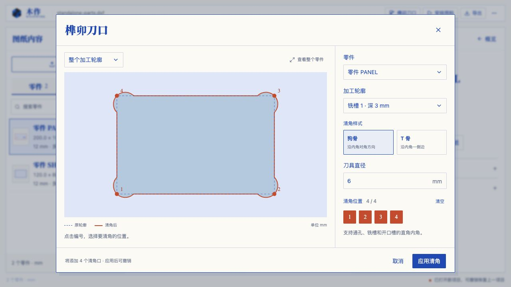
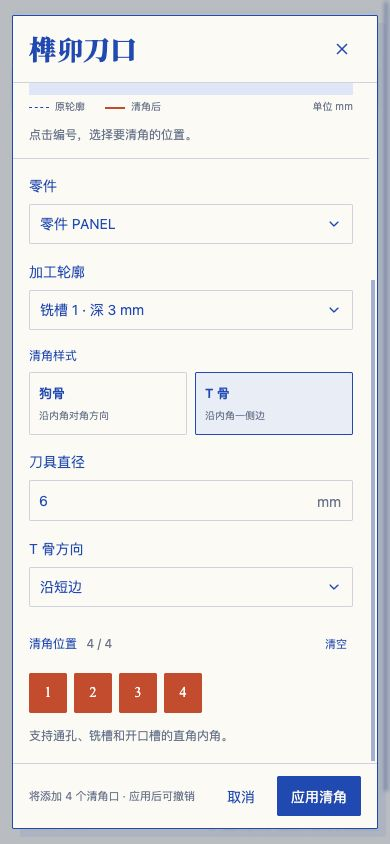
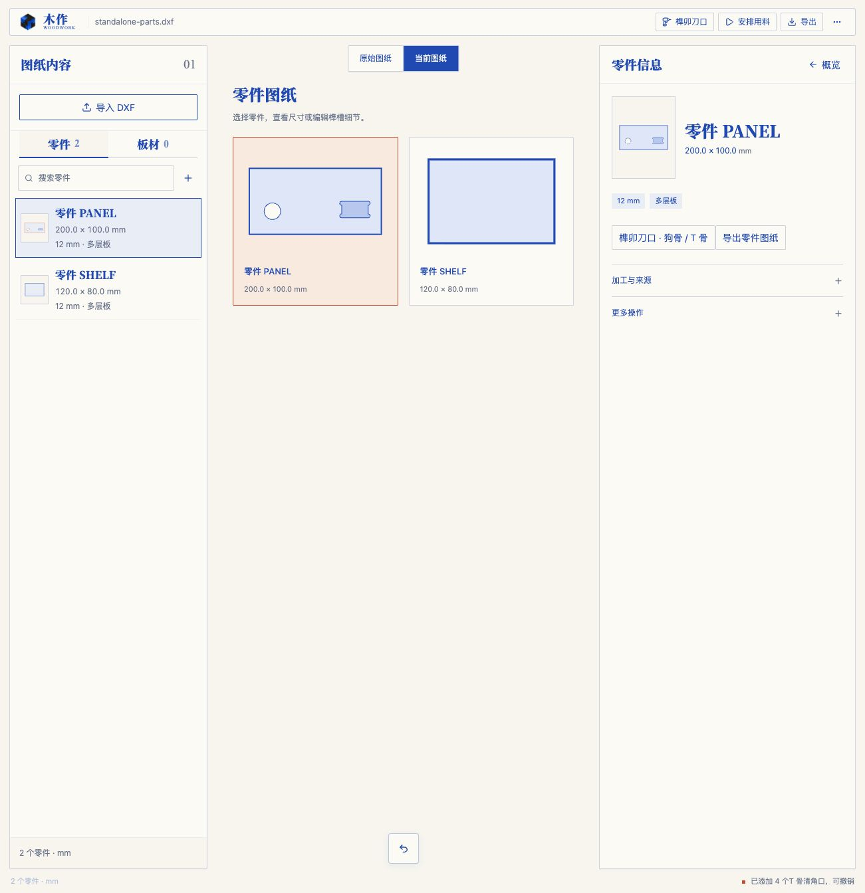
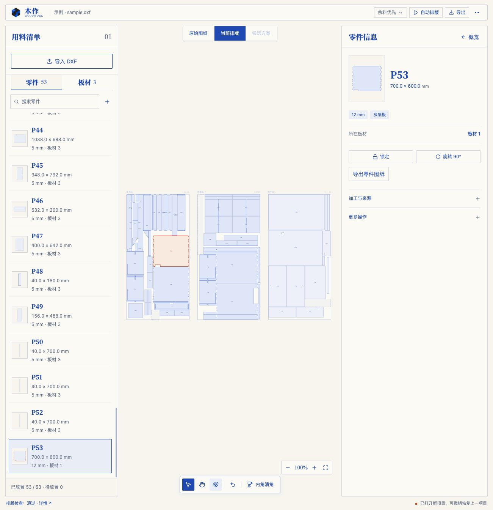
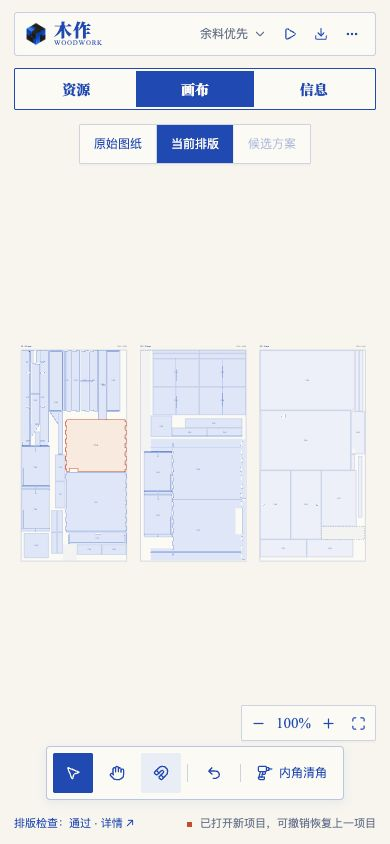
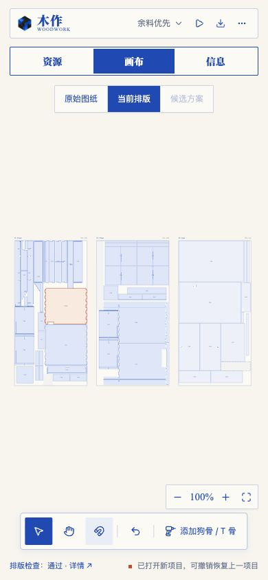

# 榫卯清角与图纸工作区验证

日期：2026-10-13。用户确认清角对象是已有榫槽，首页维持先导入、再编辑的统一流程。

## 功能与回归

- `tests/joinery-relief.test.ts`：21 项通过，验证手工推导的狗骨 / T 骨圆心、两种绕向、真实面积变化、直角角点、局部空间不足、加工区域相交、已有贴边浅槽、独立零件毫米 SVG、一次撤销事务、源图保持、搜索和只读保护以及旧候选失效。
- 最终相关回归：`pnpm exec vitest run tests/joinery-relief.test.ts tests/search-interaction.test.ts tests/final-fixes.test.ts tests/drawing-mixed-import.test.ts`，4 文件 / 80 项通过。
- `pnpm build` 通过 TypeScript 检查及 Vite 生产构建。主 JS 压缩体积约 523 kB，仍有现有的超过 500 kB 分块警告。
- 常规全量回归在同时构建时出现两项性能限时失败：DXF 点预算检查超过 5 秒，细采样凸轮廓 NFP 检查约 2.58 秒超过 2 秒。未修改对应测试或生产代码；隔离复测 `pnpm exec vitest run tests/drawing-document.test.ts tests/nesting-svgnest.test.ts --maxWorkers=1`，44 项全通过，两项耗时约 2.34 秒和 0.82 秒。
- 最终全量串行回归：`pnpm exec vitest run --maxWorkers=1`，30 文件 / 481 项全部通过，耗时 49.37 秒；未更改性能限时。

## 浏览器交互

使用本地 `http://127.0.0.1:4190/`，通过实际 UI 导入和操作，未通过脚本注入项目状态。

- 首页保留单一导入与示例入口，标题为“好木作，从图纸开始”，没有能力分类卡片。
- 示例图纸导入后选中 P53，预览外轮廓开口槽的两个内角，切换 T 骨及沿短边方向，应用后实际 SVG 轮廓变化；撤销后轮廓点串与原值完全相同。
- 上传 `public/standalone-parts.dxf`，确认外轮廓、通孔、3 mm 铣槽、12 mm 板厚及多层板，打开为新项目。导入后有两个零件、零张板材，直接显示零件图纸与图纸概览。
- 选择 PANEL，打开清角编辑器，铣槽四角预览成功。刀具直径 100 mm 时显示局部尺寸错误并禁止应用；直径 6 mm 恢复可用。逐角取消一个角点时预览显示三个清角口；取消弹窗保留原轮廓。
- 独立零件应用四个狗骨后，缩略图与信息栏同步变化。信息栏可以打开独立零件导出，选中零件及文件名正确；SVG 几何与毫米尺寸由单元测试验证。点击下载没有页面错误，但 in-app browser 的自动化下载事件未返回文件，下载落盘未作确认。
- 390 × 844 窄屏下预览、设置与页脚在屏幕内，参数区独立滚动，应用按钮保持可见；选择 T 骨沿短边并应用，显示“已添加 4 个T 骨清角口，可撤销”。检查后恢复正常 viewport。
- 最终浏览器错误日志为空。

## 预览

第一版支持直角内角；不提供机床刀路或后处理。现有未提交导入及排版工作保留，未提交或部署。

## 用户确认的入口调整（同日）

- 入口名称改为“内角清角”，移到画布底部工具栏；仅在选中零件后显示。顶部与信息栏重复入口移除。
- 弹窗显示“已选零件”，固定编辑当前选择，不再自动选择其他零件或提供跨零件切换。
- 浏览器通过实际轮廓点击选中 P53，底部显示唯一清角按钮；打开后预览与“已选零件”均为 P53。取消选择后按钮隐藏，原始图纸下禁用，当前排版恢复可用。
- 手机 390 × 844 下，资源列表选择零件会回到画布，底部按钮在屏幕内且可直接打开该零件编辑器。检查后恢复 viewport，最终错误日志为空。
- `pnpm exec vitest run tests/joinery-relief.test.ts tests/search-interaction.test.ts tests/final-fixes.test.ts tests/editing.test.ts`：4 文件 / 73 项通过；`pnpm build` 通过，保留现有分块体积警告。

## 按钮名称调整（同日）

用户反馈“内角清角”难理解后，底部按钮和弹窗标题统一改成“添加狗骨 / T 骨”，tooltip 解释为给孔槽角落增加切口、为方角配件留出空间。README 与当前设计同步。390 × 844 下工具栏完整显示（约 331 px 宽），点击按钮能打开同名弹窗；生产构建通过。此次仅修改文案，沿用已有功能回归。

## 正式命名（同日）

用户反馈“添加狗骨 / T 骨”不够正式后，工具栏按钮与弹窗标题统一改为“内角修整”；狗骨 / T 骨继续作为弹窗中的具体修整方式。tooltip 改为“修整孔槽内角，为方角配件预留装配空间”，README 与当前设计同步。文案修改后的生产构建通过，保留既有分块警告。
