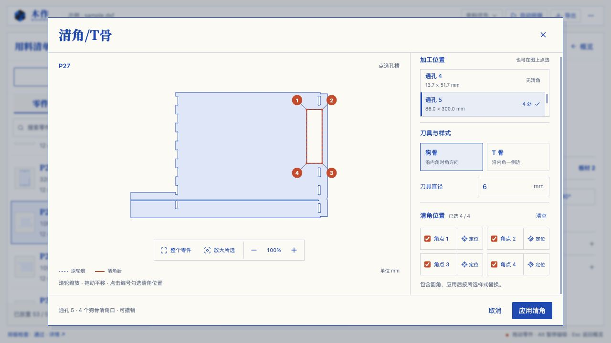
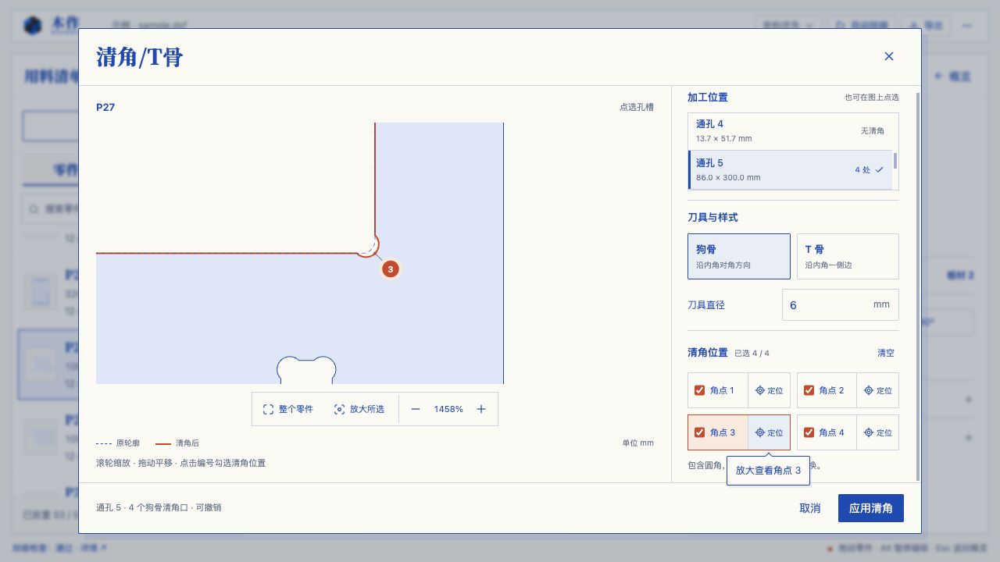

# 清角/T骨弹窗交互验证

## 交互调整

启用图纸直接点选和唯一轮廓列表，移除重复下拉框。打开从整体开始，切换轮廓适配视图。独立画布支持指针锚定滚轮缩放、加减按钮、完整零件适配、所选轮廓适配和拖动平移。

角点编号为 20 px，点击区域直径 44 px；编号移到角点旁用引线标记，避免遮挡真实刀口。薄槽使用 12 px 透明描边命中。右侧勾选与定位分开，切换轮廓保留勾选，参数变化保持视图；手机定位返回画布。侧栏按加工位置、刀具与样式、清角位置分组，选中轮廓在列表尺寸变化时保持可见，错误靠近参数。

启发式初评约 5/10：视图控制重复、缺乏自由查看、细小目标难点选。上述三类主要问题均已有对应操作和反馈；评分属于交互审查，实际使用感受仍需用户体验反馈。

## 自动验证

- 指针锚定缩放的 3 项回归先运行失败，再实现；手工推导锚点位置、缩放上下界与长宽比例。
- 完整套件 `pnpm exec vitest run --maxWorkers=1`：30 文件，491 项通过，50.09 秒。
- 收尾 `pnpm exec vitest run tests/canvas-viewport.test.ts tests/joinery-relief.test.ts`：34 项通过。
- `pnpm build`：TypeScript 和生产构建通过；仍有原有主 JS 超过 500 kB 的分块警告。
- `git diff --check` 通过。

## 浏览器实测

在独立测试标签页导入真实示例 P27，测试 1280 × 720 和 390 × 844。

- 打开缩放显示 100%，整个零件完整可见；点大孔切换到通孔 5，自动放大，显示 4 个可加工角点。细槽可直接点选，无候选时明确说明且不能应用。
- 从角点开始拖动 90 × 30 px，视图平移，四个角点和当前孔的选择没有改变；滚轮改变 viewBox，保留勾选。
- 独立定位按钮改变 viewBox，不改变已勾选或未勾选状态；修改直径与狗骨/T骨样式不重置视图。
- 通孔 5 取消勾选角点 2，切换到槽再返回，状态为 `[true, false, true, true]`。
- 放大前后四个编号圆的屏幕直径都为 20 px；图上点击和 Enter 可正确同步右侧勾选。
- 取消后主画布孔的点串完全不变。仅选角点 3 应用 T 骨，只有通孔 5 的点串改变；撤销再选择 P27，六个孔的点串与原图完全一致。
- 手机定位后滚动区域回到 0，用户能看到定位的刀口，勾选状态仍为四个全选；固定底部取消/应用仍可达。
- 最终版本另用全新标签页复核：SVG 中无 NaN/Infinity 属性，运行错误日志为空。开发过程修改相机状态字段时热更新保留过旧状态；最终全新运行不复现。

