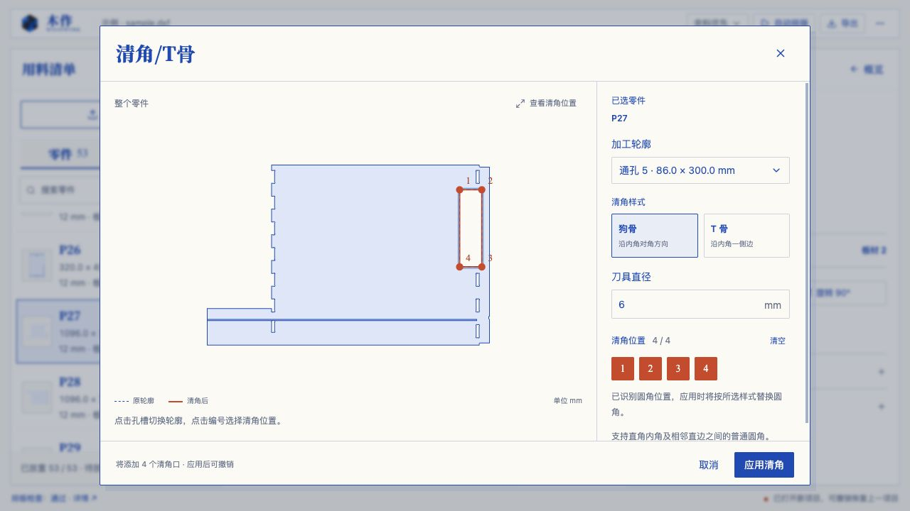

# 清角/T骨识别修正 · 2026-10-14

## 根因与真实图纸

用户截图对应示例图纸 P27。原逻辑只寻找直接相交的直边，随后将零候选轮廓从选择列表隐藏。

- 横向浅槽宽 5 mm、深 6 mm，左端的两个角点在零件外边界上，是槽口；右端是半圆。原逻辑把左端当作清角角点，默认 6 mm 刀具又触发局部空间报错。
- 大孔是通孔 5，86 × 300 mm，四角为普通 R3 圆角。没有现成直角顶点，所以原逻辑漏识别并隐藏了整个孔。
- 另外五个小通孔已有狗骨形避空，不能把这些弧段当作尚待处理的普通圆角。
- P27 外轮廓还有两处普通 R3 内圆角，恢复的虚拟位置为 (1056, 692) 和 (1056, 8)。它们与已有清角分开处理。

## 修正

全部轮廓保留在选择列表中，孔槽可在预览图中直接点击并高亮。候选角点独立判断：贴边槽口排除，共线分段视作完整直边；四分之一圆弧须通过圆拟合、相切直边与直角复核，才恢复虚拟角点。仅恢复选中的普通圆角，再用现有布尔运算生成狗骨 / T 骨；已有清角、圆形孔、半圆槽端和椭圆弧不重复处理。

圆拟合对三个跨度较大的点复核，防止先前编辑的 0.00001 mm 整数取整导致剩余圆角再次漏识别。还原和结果保留独立轮廓、边界、相交、刀具空间检查，原图和撤销事务不变。

## 验证

- 新增 7 项有实际几何预期的回归；先复现真实 P27 和合并直边的失败，再实现修正。
- `pnpm exec vitest run tests/joinery-relief.test.ts`：28 项通过。覆盖 P27 原图、普通圆角到狗骨的手工尺寸、单角 T 骨及剩余圆角、共线分段、两种绕向和闭合接缝、开口槽内圆角、椭圆排除及外边界保护。
- `pnpm exec vitest run --maxWorkers=1`：30 文件 / 488 项全部通过，52.22 秒。
- `pnpm build`：TypeScript 与生产构建通过；仍有现有主 JS 超过 500 kB 的分块警告。
- 浏览器实际点选 P27 大孔后，下拉框显示通孔 5 · 86.0 × 300.0 mm，四个位置可选，6 mm 狗骨预览和应用可用。横向铣槽和已有狗骨的小孔可查看，但显示零候选且不能重复应用。
- 选择大孔单个角点应用 T 骨后，主画布实际轮廓改变。撤销并重新选中 P27 后，孔的点串与应用前完全一致。
- 独立预览标签页复核四角选择，最终浏览器错误日志为空。

