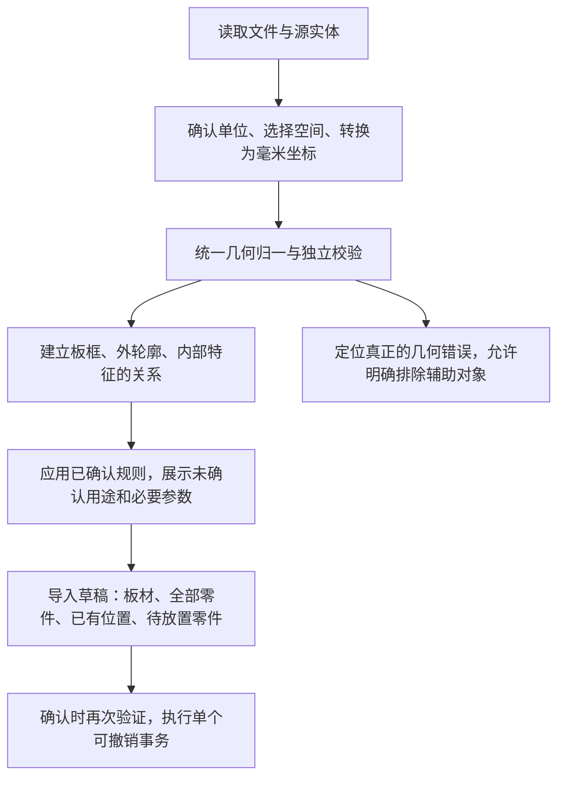

# 文件导入判断优化方案

日期：2026-10-13。状态：三个阶段已实施并验收。结果见[验收记录](../../analysis/2026-10-13-dxf-import-verification.md)。

目标：常见 CAD 导出误差由系统处理，有效零件完整保留；只有会改变加工含义或缺少必要参数的内容，才要求用户确认。

## 1. 判断分成三个问题

1. **几何是否有效？** 单位、平面、端点、曲线、闭合、自交是否满足要求。
2. **它用于什么加工？** 零件外轮廓、板框、通孔、槽区域、槽中心路径还是参考对象。
3. **零件放在哪里？** 已在一张板内、尚未放置、跨板边界或被多个板框包含。

三个问题分别判断。未确认用途不等于无法读取；未放置不等于轮廓无效；首尾近重复不等于真的缺了一段槽边界。

保留已实施的读取、工艺核对和项目构建分层，不增加针对某个图层名、尺寸或示例布局的判断分支。继续使用当前解码与几何库；这次问题位于导入适配层，不需要先替换解析库。

## 2. 自动处理和用户确认的边界

| 情况 | 系统行为 | 用户需要做什么 |
| --- | --- | --- |
| 首尾近重复，归一后形成有效区域 | 自动归一，记录原始端点、修改量和结果 | 可展开查看处理记录，无需逐个修复 |
| 真正开放的线或链 | 保留原路径，可预览 | 选择槽中心路径、连接边界或参考对象 |
| 自交、分支、明显缺边、不可读取的加工实体 | 定位具体实体，阻止将其作为有效加工轮廓提交 | 修正源图，或明确排除该对象 |
| 内部闭合轮廓，用途未知 | 建议“内部加工”，保留几何 | 确认通孔或槽；槽填写深度 |
| 唯一落在一张已确认板框内的零件 | 建立原始放置关系 | 确认对应板厚和材质 |
| 完全在所有板框外的有效零件 | 加入待放置，保留源图位置用于核对 | 确认待放置件板厚和材质 |
| 与板框边界相交，或同时属于多个板框 | 定位归属冲突，不生成猜测的放置关系 | 选择待放置或明确所属板；所属板必须通过完整包含检查 |
| VIEWPORT、尺寸等已知显示对象 | 不生成加工路径，列入读取摘要 | 不增加待处理事项 |
| 未知实体 | 保留来源和诊断 | 明确用途或排除；不能默认按辅助对象丢弃 |

系统不能因为文件能够显示，就宣称加工数据完整；也不能因为板上暂时没放全零件，就拒绝保存这些零件。

## 3. 几何归一：统一物理容差

### 3.1 容差使用毫米坐标

先应用单位、块实例与平面坐标变换，再判断端点距离。不能在原文件坐标上使用同一个常数，导致毫米、厘米、英寸文件判断不同。

本轮建议固定以下内部参数，不增加普通用户的设置项：

| 参数 | 建议值 | 用途 |
| --- | --- | --- |
| 端点归一容差 | 0.001 mm | 判断近重复首尾点和无歧义链端点 |
| 曲线采样误差 | 沿用 0.025 mm | 控制排版多边形对真实曲线的近似 |
| 孔槽归属容差 | 沿用 0.05 mm | 处理父子轮廓独立采样产生的薄层偏差 |

0.001 mm 是本方案的工程默认值，实施时由边界测试验证。三类容差不得混用，也不直接放宽全局自交判断的 EPS。0.025 或 0.05 mm 不能成为自动补缺边的许可。

### 3.2 首尾近重复的处理条件

自动闭合必须同时满足：

- 原实体已经沿路径返回起点附近；首尾毫米距离不超过 0.001 mm。
- 至少能形成三个不同且不共线的有效区域顶点；两点线段不能自动变成区域。
- 只归一同一路径的重复端点，不焊接相邻零件或独立内轮廓。
- 保留起点和真实弧段；归一末端后仍通过独立区域有效性检查。
- 不新增自交、分支、归属冲突或超限复杂度。
- 不覆盖用户已明确指定的“槽中心路径”画法。此时使用保留的原始开放路径。

归一在独立派生几何上执行。保留原始闭合标记、被修改的原始端点、实体来源和处理日志，原 DXF 文件不改写。用户可以查看处理前后叠图，恢复原始路径并重新指定用途。

### 3.3 处理顺序

1. 在变换后的真实曲线/顶点上检测重复端点。
2. 删除真正重复的末点，消除它产生的微小回折或退化闭合边。
3. 保留弧段的 bulge/曲线信息，再按原采样误差生成区域多边形。
4. 验证闭合、面积、自交、顶点预算与完整区域归属。
5. 成功则记录“已归一首尾端点”；失败则保留原路径并给出具体原因。

不能仅按弧段两端很近就删除弧段：端点接近的圆弧仍可能表达完整圆或重要加工形状。不能批量删除所有短边，也不能先粗采样再根据屏幕上看着相接而闭合。

LINE/ARC 链沿用同一个毫米端点政策，只连接具有唯一匹配关系的端点。多个匹配或分支要求核对；连续合并不得通过传递关系把超过容差的端点群焊接起来。

真正的开放边界仍使用已有显式“连接两端成区域”操作；新增边用虚线显示并独立校验。中心路径仍填写槽宽、槽深，实际展开区域必须唯一归属零件。环形中心线或展开后多边界不能被错误表示成实心槽。

## 4. 用途判断：建议与确认分开

采用以下优先级：

1. 用户对单个图形的明确设置。
2. 用户对当前图层的明确设置。
3. 用户主动应用的已保存图层模板。
4. 用户选择的、含义已验证的来源格式预设。
5. 基于已确认外轮廓和完整包含关系的几何建议；图层名和颜色不推断加工用途。

第 5 项不能直接写成已确认的加工用途；不使用未经验证的数值“置信度”。每项建议显示简短依据，例如“闭合轮廓，位于零件 A 内”。显式规则与几何矛盾时显示冲突，不让猜测覆盖规则。

### 4.1 包含关系能判断什么

- 已确认外轮廓内的闭合区域：内部加工候选。
- 已确认板框内的外轮廓：板内零件候选。
- 矩形且包含多件零件：可以建议板框，但需要确认，不能将最大的矩形直接当库存。
- 嵌套关系必须在区分板框和零件后建立；位于板框内不能成为“孔”的依据。

通孔和浅槽可能具有完全相同的二维边界。没有用户规则或明确工艺数据时，不自动决定切穿与否。嵌套内轮廓表达槽内岛等当前模型不能表示的情况，需要诊断，不能压平成普通实心槽。

### 4.2 混合图层

图层是批量配置入口，不是“整层必须一个用途”的限制。允许多选图形批量指定用途，并保留单图形覆盖；预览显示覆盖数量和用途分布。

本次文件的 `TOP-CUT-INSIDE_18.000MM` 同时包含 4 个短槽和 4 个其他内轮廓。短槽用途来自用户此前明确说明；不能把“近重复端点”写成“必然是槽”的规则，也不能把这份文件的尺寸写进通用分类器。

模板继续保存图层用途、画法和明确填写的工艺参数，不保存跨文件复用的实体 handle。用户主动应用模板可批量确认对应规则；已知混合图层显示覆盖范围，保留当前单图形覆盖。新文件重新验证几何，不能靠旧文件的 handle 或尺寸复用单图形结论。

### 4.3 参数分别确认

- 板厚、材质：板材参数或待放置零件参数。
- 槽深：加工参数，必须大于 0 且小于该零件实际板厚。
- 槽宽：只有中心路径需要填写；区域边界已经表达形状，不要求额外加宽。
- 数字后缀：只有明确选定的格式预设或用户规则才能解释它的含义；不能把同一个 18/12 数字同时用作板厚、槽宽和槽深。

来源未知的图层 `0` 不再默认承担外轮廓或板框含义。既有示例的约定保留为兼容预设，不作为所有 CAD 文件的工艺规范。

## 5. 板框内外零件：允许混合状态

### 5.1 两种导入模式的结果

| 模式 | 板材 | 零件 | 原始放置 |
| --- | --- | --- | --- |
| 整板图纸 / 保留原排版 | 写入已确认的板框 | 保留全部已确认外轮廓 | 唯一归属板框的零件保留位置；框外件待放置 |
| 零件轮廓 / 全部待放置 | 板框仅保留为原图参考，不新增库存 | 保留全部已确认外轮廓 | 不创建放置；全部进入待放置列表 |

有已确认板框时可推荐“保留原排版”，但用户选定模式后不能再自动切换。没有板框时不根据零件外包尺寸虚构板材。

### 5.2 零件与库存分别建模

`Project.parts` 表达所有零件，`original.placements` 只表达已经有原始位置的零件；两者数量可以不同。沿用当前待放置机制，通过缺少 placement 表达未放置，不增加重复的状态字段。

框外零件 `stockId` 留空，单独保留材质和板厚。不能把它们绑定到最近板框，也不能自动平移到板内。原图预览仍显示其真实 CAD 位置；工作区待放置预览使用零件自身局部几何。

孔槽先唯一归属零件，再转换到该零件的局部坐标；所属零件尚未放置不影响特征保留。已放置件使用所属板框坐标变换，框外件使用自身局部坐标变换，不能让孔槽或编号处理依赖一定存在的板框/placement。

跨板边界与多板归属冲突不能自动视为普通框外件。用户可以选择“作为待放置零件导入”，保留几何但放弃该件原始放置；若选择所属板，则必须通过全轮廓包含验证。

### 5.3 元数据与后续操作

混合文件同时显示板材参数和“待放置零件参数”。待放置件可按确认后的材质/板厚组合批量填写，但不自动继承邻近板材参数。

确认时同时校验板上件和待放置件的材质、板厚、槽深。追加、打开新项目、撤销、恢复原图均保留混合状态。恢复原图恢复 39 个原位置，并保留 3 个待放置件；不自动创建它们的原始 placement。

排版搜索必须包含全部零件。未放全的结果不显示成完整优化结果；导出继续执行现有完整性和几何检查，不能因“原图导入成功”就宣称 42 件都已完成排版。

## 6. 核对界面：按结果展示

顶部先给完整摘要，所有计数针对当前选定空间，且在用途变化时同步更新：

> 读取 54 个图形 · 已归一 6 个端点问题 · 2 张板材 · 42 个零件 · 39 个有原位置 · 3 个待放置

“42 个零件”仅在外轮廓用途已确认后显示为确定数量；确认前标为候选。参考对象和用户排除对象分别统计，不能计入零件。

界面只将真正未处理事项计入待处理数量：

- **自动处理记录**：默认折叠，例如“已归一 6 个近重复首尾点”；可定位并查看原/归一几何。
- **需要确认**：未知用途、缺槽深、单位、元数据或几何/归属冲突，直接提供对应操作。
- **待放置零件**：正常导入结果，显示数量和列表，不使用错误样式。
- **辅助与排除对象**：默认折叠；用户明确排除可以恢复核对。

原图上：选中图形显示 handle、图层、角色及尺寸；点击待处理项定位。元数据缺失不抹掉已读取的几何预览。多个错误一次收集，不以第一个异常遮蔽后续内容。

确认前建立源实体归宿清单：每个加工对象必须属于零件外轮廓、内部特征、板框、待确认或明确排除；辅助对象另列。实体数量与零件数量不是一一对应，LINE/ARC 链、块实例要按来源关系核对，不能用一个总数代替漏件检查。

## 7. 实施位置与顺序

### 第一阶段：归一真实 CAD 导出误差

- 新增 `src/core/drawingNormalization.ts`：毫米容差、区域首尾归一与处理日志，返回派生几何，不修改来源。
- 修改 `drawingDocument.ts`、`drawingTypes.ts`、`drawingReview.ts`：保存必要的原始端点/闭合标记，统一实体类型判断，自动处理记录不再成为阻断项。
- 修改 `DrawingReview.tsx`：读取摘要、处理记录、恢复原路径及两种几何叠图。
- 新增 `tests/drawing-normalization.test.ts`，沿用已有文档/槽用例。
- 第一阶段独立结果：这份文件的 6 项首尾误差不再要求用户手工修复；工艺未确认仍明确保留。

### 第二阶段：混合板内与待放置导入

- 修改 `drawingProject.ts`：先创建全部零件，再建立可确定的板内放置；孔槽和标签的局部变换按零件上下文执行。
- 修改 `importTransaction.ts`：板材与待放置件均需元数据校验；去掉“项目有板材则每个零件一定有所属板”的假设。
- 修改 `ImportPreview.tsx`、`ImportDrawingPreview.tsx`：同时展示板材与待放置列表、独立元数据输入。
- 验证 `store.ts` 的确认、追加、取消、恢复、撤销及搜索；验证 `export.ts` 的完整性检查。
- 新增 `tests/drawing-mixed-import.test.ts`，补充现有事务与预览回归。
- 第二阶段独立结果：2 板、42 件、39 个原位置、3 个待放置可作为一个事务确认。

### 第三阶段：用途建议和集中核对

- 修改 `drawingReview.ts`、`drawingTemplates.ts`、`DrawingReview.tsx`：区分建议和确认、显示建议依据，支持多选批量设置和冲突定位。
- 保留并明确既有示例格式预设，陌生图层不套用它的语义。
- 同步导入帮助和支持范围，不声称能够从任意二维图纸自动识别所有加工含义。
- 第三阶段独立结果：用户集中确认未知用途和必要参数，不逐个处理已归一或只是未放置的对象。

三个阶段均先增加失败回归、实现后再验证，不同时改动排版算法。原有 2 MB 文件、4096 单实体顶点、50,000 总顶点、1000 件、块数量和嵌套深度上限继续生效；派生加工几何也计入顶点上限。

## 8. 验收矩阵

| 测试输入 / 操作 | 必须得到的结果 |
| --- | --- |
| 首尾距离 0、0.000004、0.0009、0.001 mm 的有效区域 | 归一成功，尺寸变化受 0.001 mm 限制，来源可追溯 |
| 首尾距离 0.002 mm 的未闭合区域 | 保留开放状态，不自动补边 |
| 两点短线，或用户明确选择中心路径 | 不自动变成区域；中心路径仍使用原始端点 |
| 带 bulge 的近重复端点、闭合圆弧 | 真弧段保留，不因端点接近而删掉圆弧 |
| 归一后自交、分支、零面积 | 阻断，并定位原因 |
| 同几何的 mm/cm/inch 文件，含缩放块 | 毫米归一结果与角色判断一致 |
| 端点群具有传递接近关系，或匹配不唯一 | 不跨容差串联焊接，不猜分支 |
| 同层通孔、区域槽、中心路径，含单图形覆盖 | 优先级正确；用途、宽度和深度分别验证 |
| 缺加工用途，或只有 18/12 数字后缀 | 可预览，待确认；不伪造加工参数 |
| 有效孔槽属于待放置零件 | 全部保留，局部几何与板内路径一致 |
| 跨板、多板包含、明显超边界 | 定位冲突；转待放置必须由用户明确选择 |
| 两张旋转板框 + 板外件 | 板上坐标正确，板外件不依赖板框轴系 |
| 混合项目确认、追加、撤销、恢复 | 零件数量、特征、元数据、原位置和待放置数量一致 |
| 待放置件缺材质/板厚，或槽深不小于板厚 | 确认失败，定位对应参数，不发生空板引用错误 |
| 模板复用到另一文件，或同文件改单位 | 几何重新验证，手工毫米参数保持；不复用旧 handle |
| 确认前取消、换文件、迟到 Worker 响应 | 当前工作区不改变，旧文件设置不污染新文件 |
| 搜索与导出包含待放置件 | 搜索目标覆盖全部件；未放全不能宣称完成排版 |
| 既有 sample.dxf | 3 板 / 53 件 / 28 孔 / 29 槽及原始坐标不变 |

当前用户文件最终验收：

- 54 个模型空间图形均有归宿；VIEWPORT 保留为辅助显示记录。
- 6 项近重复端点自动归一，6 个已由用户说明用途的槽区域完整保留，槽深仍需填写。
- 42 个外轮廓、2 张 1220 × 2440 mm 板材。
- 32 件在第一板、7 件在第二板、3 件待放置，位置不擅自调整。
- 另外 4 个内轮廓分别确认用途；如果用户选择通孔，则得到 4 孔 / 6 槽，不能把这个条件结果提前当成确定工艺。
- 用户原始文件不改写；取消不修改项目，确认是一个可撤销事务。

最终检查命令：`pnpm exec vitest run --maxWorkers=1 --no-file-parallelism`、`pnpm build`、`git diff --check`。浏览器验证实际文件、单位重读、混合元数据、取消/确认/撤销，以及 320 px 和桌面宽度。

## 9. 方案取舍

| 路径 | 取舍 |
| --- | --- |
| 增加特定图层名或样例尺寸规则 | 很快解决一个文件，但不能处理单位、端点、混合工艺和框外件；不采用 |
| 立即整体替换 DXF 解码库 | 可扩大部分实体支持，但解码库不能决定加工含义，也不解决当前 Project 和元数据的混合状态；本轮不作为前提 |
| 在现有分层中补统一归一、关系判断和混合草稿 | 对准已验证根因，保留现有能力和验证边界；本方案采用 |

当前阶段不新增 AI 工艺猜测、普通用户容差设置、云端文件处理或 CNC 刀路生成。来源格式预设仅在规则经过验证后加入，不用未经确认的厂家命名推断参数。

依据：[实际文件检查记录](../../analysis/2026-10-13-dxf-inspection.md)、[既有通用导入架构](../../design/dxf-import-compatibility.md)及当前代码。三个阶段的实现与限制已按[验收记录](../../analysis/2026-10-13-dxf-import-verification.md)核对。
